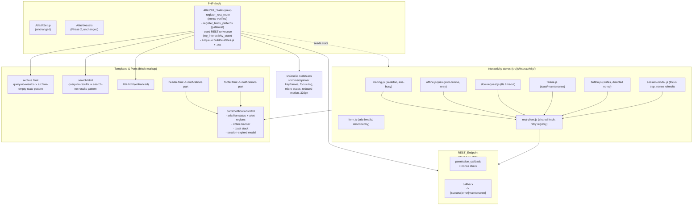

# Design Document

## Overview

This design delivers the accessible UI-state system described in `requirements.md` for the Atlas Multipurpose FSE block theme (WordPress 6.8+, PHP 8.1+). It layers onto the existing Phase 2 architecture already present in `theme/`: a thin `functions.php` loader with a hand-rolled `Atlas\` autoloader, `Atlas\Setup` (theme supports, textdomain, main stylesheet), and `Atlas\Assets` (Phase 2 Interactivity script modules). The new work follows those exact conventions rather than inventing new ones.

The system has three layers, mirroring the three requirement phases:

- **Static presence states (Phase 1)** — block patterns in `theme/patterns/` wired into the existing `wp:query-no-results` blocks of `archive.html` and `search.html`, plus an enhanced `404.html`. Pure server-rendered block markup. Covers Requirements 1, 2, 3.
- **Asynchronous feedback (Phase 2)** — a nonce-verified REST route (the single async contract), a reusable `parts/notifications.html` template part hosting centralized `aria-live` regions / offline banner / toasts / session modal, and Interactivity API store modules in `theme/src/js` driving loading, offline, slow-request, and failure/maintenance behavior. Covers Requirements 4, 5, 6.
- **Interaction states (Phase 3)** — store modules and CSS for form input states, button states, submission feedback, and the session-expired modal with focus trap and nonce refresh. Covers Requirements 7, 8, 9.

Requirement 10 (Accessibility and Compliance Baseline) is cross-cutting and is satisfied by shared decisions threaded through every component: semantic markup, `aria-live` announcements, a `:focus-visible` focus ring built from the `primary` preset token, keyboard operability, `prefers-reduced-motion` fallbacks, preset-variable-only CSS, 320px responsiveness, no-layout-shift reservations, server-side nonce verification, escaped output, and `atlas-theme` i18n.

### Key design decisions

- **One PHP concern, following the `Atlas\Assets` precedent.** A new static class `Atlas\UI_States` (file `inc/class-ui-states.php`, resolved by the existing autoloader) owns the REST route, pattern registration, Interactivity state seeding (REST URL + nonce), and the enqueue of the new built module + stylesheet. `Atlas\Setup` and `Atlas\Assets` are left untouched; `functions.php` gains one line: `Atlas\UI_States::init();`.
- **Seed REST URL + nonce via `wp_interactivity_state`, not `wp_localize_script`.** The theme uses script *modules* (`wp_register_script_module`), and localize does not apply to modules. The established Phase 2 pattern already seeds server values into the store with `wp_interactivity_state( 'atlas/...', [...] )`; we reuse it so JS reads config from the store instead of a global.
- **Build output matches the existing module convention.** `wp-scripts build --experimental-modules` emits `build/{entry}.js` + `build/{entry}.asset.php`. We add a single new entry, `ui-states`, that imports the per-concern store modules from `src/js/interactivity/`. `Atlas\UI_States` registers/enqueues it exactly like `Atlas\Assets` does its modules (read `.asset.php` for deps + version, fail-closed if the build is absent).
- **One built stylesheet from `src/css`.** `wp-scripts` compiles `src/css/ui-states.css` to `build/ui-states.css` (via the `ui-states` entry's CSS import) and we enqueue the built file. All values are `theme.json` preset variables only.
- **Centralized notifications region.** A single `parts/notifications.html` is referenced from both `header.html` and `footer.html` so the live regions, offline banner, toast stack, and session modal mount on every template exactly once, giving all store modules a stable, shared mount point.

### Technology and conventions

Code examples use PHP 8.1 (WordPress Coding Standards, as enforced by `.phpcs.xml.dist`), block-markup HTML for templates/patterns/parts, and JavaScript using `@wordpress/interactivity` (matching `src/js/theme-mode.js`). CSS uses only `var(--wp--preset--...)` tokens from `theme.json`.

## Architecture



### Request / response lifecycle (async states)

```mermaid
sequenceDiagram
    participant U as User
    participant S as Store (loading/button)
    participant C as rest-client.js
    participant R as REST_Endpoint
    participant N as Notifications part

    U->>S: trigger action
    S->>S: status=loading (skeleton, aria-busy=true)
    S->>C: request(endpoint,args,nonce)
    C->>C: start 8s timer; remember as "last request"
    alt offline (navigator.onLine == false)
        C-->>N: offline banner (aria-live status)
    else online
        C->>R: fetch (X-WP-Nonce)
        Note over C,R: if >8s elapsed -> slow-request notice (status)
        alt nonce invalid
            R-->>C: 401/403 auth error
            C-->>N: session-expired modal (if logged-in expiry)
        else maintenance status
            R-->>C: 503 maintenance
            C-->>N: maintenance notice (alert)
        else error
            R-->>C: error
            C-->>N: failure toast + retry (alert)
        else success
            R-->>C: data
            S->>S: status=idle (aria-busy=false, content)
            C-->>N: success toast (status)
        end
    end
```

## Components and Interfaces

### 1. `Atlas\UI_States` (PHP concern) — `inc/class-ui-states.php`

A static registrar mirroring `Atlas\Assets`. Resolved by the existing `Atlas\` autoloader. Wired from `functions.php` after `Atlas\Assets::init();`.

Responsibilities and public surface:

```php
namespace Atlas;

class UI_States {
    const REST_NAMESPACE = 'atlas/v1';
    const REST_ROUTE     = '/ui-state';
    const STORE          = 'atlas/ui-states';
    const HANDLE         = 'atlas-ui-states';

    // Hook wiring: init (patterns), rest_api_init (route),
    // wp_enqueue_scripts (seed state + enqueue build assets).
    public static function init(): void;

    // register_rest_route with a nonce-enforcing permission_callback.
    public static function register_rest_route(): void;

    // permission_callback: wp_verify_nonce( X-WP-Nonce, 'wp_rest' );
    // returns WP_Error (rest_cookie_invalid_nonce, status 401/403) on failure.
    public static function verify_nonce( \WP_REST_Request $request ): bool|\WP_Error;

    // callback: returns the single async contract response shape.
    public static function handle_request( \WP_REST_Request $request ): \WP_REST_Response;

    // register_block_pattern() for every file in patterns/ (category + slugs).
    public static function register_block_patterns(): void;

    // wp_interactivity_state( STORE, [ 'restUrl' => ..., 'nonce' => ..., labels ] )
    // + register/enqueue build/ui-states.js (module) and build/ui-states.css.
    public static function register_assets(): void;
}
```

Design notes:

- **Nonce verification (R6.5, R10.9).** `permission_callback` is the single gate. It reads the `X-WP-Nonce` header and calls `wp_verify_nonce( $nonce, 'wp_rest' )`. On failure it returns a `WP_Error` with HTTP `401`/`403` so no handler runs and no data is returned. This is the one place the contract enforces authentication.
- **Single async contract (R4, R5, R6, R9).** `handle_request` returns one stable response shape so the client has a single code path for retry/timeout/maintenance/success:
  ```json
  { "status": "success|error|maintenance", "data": {}, "message": "<translatable>" }
  ```
  A maintenance condition returns `status: "maintenance"` (HTTP 503); recoverable errors return `status: "error"`; success returns `status: "success"`. Session expiry surfaces as the nonce auth error (401/403), which the client maps to the session modal.
- **Pattern registration (R1.1, R2.1).** `register_block_patterns` registers a block pattern category (`atlas`) and each pattern in `patterns/`. Patterns use header-comment metadata (`Title`, `Slug`, `Categories`) per WordPress pattern-registration conventions, so `register_block_patterns_from_directory`-style discovery or explicit `register_block_pattern` calls both satisfy the requirement; the slugs are `atlas/archive-empty-state` and `atlas/search-no-results`.
- **Asset enqueue (Assets_Concern, R4, R10.6).** Follows the `Atlas\Assets::register_assets` pattern precisely: read `build/ui-states.asset.php` for dependencies (`@wordpress/interactivity`) and version, `wp_register_script_module` + `wp_enqueue_script_module`, skip if the build is absent (fail closed to no-JS), and `wp_enqueue_style` the built `build/ui-states.css`. Before enqueue, `wp_interactivity_state( self::STORE, [...] )` seeds `restUrl` (`rest_url( self::REST_NAMESPACE . self::REST_ROUTE )`), `nonce` (`wp_create_nonce( 'wp_rest' )`), the slow threshold (`8000` ms), and pre-translated gettext labels so JS performs no runtime i18n (matching the theme-mode precedent).

### 2. REST_Endpoint — `atlas/v1/ui-state`

- Route registered under namespace `atlas/v1`, path `/ui-state`, methods `GET`/`POST`.
- `permission_callback` → `Atlas\UI_States::verify_nonce` (nonce required on every request — R10.9).
- `callback` → `handle_request`, returning the single contract shape above.
- Serves as the one endpoint the client uses for retry (R5.3, R6.2), timeout detection (R5.4), maintenance (R6.3), and success/form submission (R9.3). It does not itself render UI.

### 3. `parts/notifications.html` (Notifications_Part)

New reusable template part referenced from `header.html` and `footer.html`. It mounts the shared interactive regions once per page. Structure (block markup; all strings use `atlas-theme`; `data-wp-interactive="atlas/ui-states"`):

- **Live regions (R5.5, R6.4, R10.2):**
  - A polite region: `<div role="status" aria-live="polite" aria-atomic="true">` for non-urgent announcements (offline, slow-request, success).
  - An assertive region: `<div role="alert" aria-live="assertive" aria-atomic="true">` for urgent announcements (failure, maintenance).
- **Offline banner (R5.1–R5.3):** a region bound to the offline store, hidden by default (`data-wp-bind--hidden`), containing a message and a retry `<button>` (`data-wp-on--click="actions.retry"`).
- **Slow-request notice (R5.4):** a text node written into the polite live region.
- **Toast stack (R6.1, R6.3, R9.3):** a container the failure/success modules append toasts into; each toast carries a retry control where applicable.
- **Session-expired modal (R9.4–R9.6):** a `role="dialog"` `aria-modal="true"` element, hidden by default, with a labelled heading, a re-authentication control, and first/last focus sentinels for the trap.

The part ships its interactive controls progressively enhanced (regions present but inert without JS), consistent with the header's existing `hidden` + `data-wp-init` reveal pattern.

Header/footer wiring:
- `header.html`: add `<!-- wp:template-part {"slug":"notifications"} /-->` near the top of the header group.
- `footer.html`: add the same reference so regions exist even on templates whose header is minimal. The part is idempotent in markup; the store initializes a single instance.
- `theme.json` `templateParts` gains an entry `{ "name": "notifications", "title": "Notifications", "area": "uncategorized" }`.

### 4. Block patterns — `theme/patterns/`

**`archive-empty-state.php`** (slug `atlas/archive-empty-state`, R1):
- Heading + explanatory paragraph (gettext, `atlas-theme`).
- A call-to-action link to `home_url()` using `esc_url( home_url( '/' ) )` and `esc_html__` label (R1.3, R1.5).
- Referenced inside `archive.html`'s `wp:query-no-results` block, replacing the current placeholder paragraph (R1.2).

**`search-no-results.php`** (slug `atlas/search-no-results`, R2):
- Heading + paragraph (gettext).
- A search input via `wp:search` block (R2.3).
- Suggested tags and categories rendered as navigable links from `get_terms()` / `get_categories()`, each `esc_url( get_term_link( $term ) )` + `esc_html( $term->name )` (R2.4). Only existing terms are rendered; term names are escaped so arbitrary names cannot inject markup (R2.6).
- Referenced inside `search.html`'s `wp:query-no-results` block, replacing the current placeholder (R2.2).

Patterns are PHP files (so dynamic term lookups and escaping run at render) registered by `Atlas\UI_States::register_block_patterns`.

### 5. Enhanced `404.html`

Enhancements to the existing template (R3):
- Keep the semantic `<main id="atlas-main">` and `<h1>` structure.
- Keep/confirm the `wp:search` block (R3.2).
- Add a call-to-action link group to `home_url()` using an escaped URL and translatable label (R3.3).
- All strings use `atlas-theme` (R3.4); any dynamic output escaped (R3.5).

### 6. Interactivity store modules — `theme/src/js/interactivity/`

All modules register on the single namespace `atlas/ui-states` (one store, multiple slices) matching the `src/js/theme-mode.js` style (`import { store, getElement } from '@wordpress/interactivity'`). A single build entry `src/js/ui-states.js` imports them so one module ships.

| Module | File | Responsibility | Requirements |
|---|---|---|---|
| REST client | `rest-client.js` | Shared `fetch` wrapper: injects `X-WP-Nonce`, starts the 8s timer, records the "last request" descriptor for retry, classifies responses into success/error/maintenance/auth-error. | 4,5,6,9 |
| Loading / skeleton | `loading.js` | Derives skeleton visibility and `aria-busy` from request status for content regions. | 4.1–4.3 |
| Button | `button.js` | Per-button loading state, inline spinner, `aria-busy`; blocks activation while disabled. | 4.4, 8.5–8.6 |
| Offline | `offline.js` | Listens to `online`/`offline`; toggles offline banner; retry re-dispatches last failed request. | 5.1–5.3 |
| Slow request | `slow-request.js` | Shows slow notice when elapsed time crosses the 8s threshold. | 5.4 |
| Failure / maintenance | `failure.js` | Classifies error vs maintenance responses; shows the matching toast/notice with retry; success toast on success. | 6.1–6.4, 9.3 |
| Form | `form.js` | Validation state: `aria-invalid` tracking, inline error with `aria-describedby`, disabled state. | 7.2–7.4 |
| Session modal | `session-modal.js` | On session-expiry auth error: show modal, move + trap focus, refresh nonce on re-auth. | 9.4–9.6 |
| Comment feedback | `comment-feedback.js` | Maps comment-submission outcome to submitted vs pending-moderation banner. | 9.1–9.2 |

Store seams (illustrative, matching the existing getter/action/callback shape):

```javascript
// rest-client.js
const { state, actions } = store( 'atlas/ui-states', {
  actions: {
    *request( { endpoint, args } ) {
      state.lastRequest = { endpoint, args };      // for retry (R5.3/R6.2)
      if ( ! navigator.onLine ) { actions.showOffline(); return; }
      const timer = setTimeout( actions.markSlow, state.slowThreshold ); // R5.4
      const res = yield fetch( endpoint, withNonce( args, state.nonce ) );
      clearTimeout( timer );
      return actions.classify( res );              // success|error|maintenance|auth
    },
    *retry() { return yield actions.request( state.lastRequest ); }, // R5.3/R6.2
  },
} );
```

```javascript
// loading.js — aria-busy mirrors status (R4.2/R4.3 invariant)
get ariaBusy() { return getContext().status === 'loading' ? 'true' : 'false'; }
get showSkeleton() { return getContext().status === 'loading'; } // R4.1
```

### 7. CSS — `theme/src/css/ui-states.css`

Authored with `theme.json` preset variables only (R10.6). Imported by the `ui-states` entry so `wp-scripts` emits `build/ui-states.css`. Contents:

- **Shimmer + spinner keyframes** for skeleton cards and inline button spinner (R4.1, R4.4), using preset color tokens for the gradient stops.
- **Skeleton card dimensions** reserved with fixed `min-height`/aspect ratios so loaded content occupies the same box — no layout shift (R4.5, R10.8).
- **Focus ring** (`Focus_Ring`): `:focus-visible { outline: 2px solid var(--wp--preset--color--primary); outline-offset: 2px; }` applied to every interactive element (R7.1, R8.4, R10.3).
- **Button states** (R8): default via preset tokens, `:hover`, `:active`, `:focus-visible`, `:disabled` (distinct + `pointer-events: none` paired with the JS activation guard), and a loading modifier class.
- **Form input states** (R7): focus ring, `[aria-invalid="true"]` styling, inline error styling, `:disabled` distinct state.
- **Notifications styling**: offline banner, toast stack, modal/overlay, all using preset spacing/color/typography.
- **`prefers-reduced-motion: reduce`** block that disables shimmer/spinner animation and renders a static placeholder, and removes all other motion (R4.6, R10.5).
- **320px responsiveness**: fluid widths, wrapping, and `max-width: 100%` on media so no horizontal overflow occurs at 320px (R10.7).

## Data Models

**Interactivity store state (`atlas/ui-states`)** — seeded by PHP, extended at runtime:

```
state (global, seeded by wp_interactivity_state):
  restUrl: string            // rest_url('atlas/v1/ui-state')
  nonce: string              // wp_create_nonce('wp_rest'); refreshed by session modal
  slowThreshold: number      // 8000
  labels: { offline, slow, failure, maintenance, success,
            sessionExpired, commentSubmitted, pendingModeration } // pre-translated

state (runtime):
  isOffline: boolean
  lastRequest: { endpoint: string, args: object } | null
  toasts: Array<{ id, kind: 'error'|'maintenance'|'success', message, retryable }>
  announce: { polite: string, assertive: string }   // mirrored into live regions
  session: { modalOpen: boolean }

context (per-region, via data-wp-context):
  status: 'idle' | 'loading'   // content region / button
  valid: boolean               // form field
  errorId: string              // form field error element id
  disabled: boolean            // button/input
```

**REST contract response** (single shape across all async states):

```
{ status: 'success' | 'error' | 'maintenance', data: object, message: string }
```

**Block pattern metadata** (header comments): `Title`, `Slug` (`atlas/archive-empty-state`, `atlas/search-no-results`), `Categories` (`atlas`), `Text Domain` (`atlas-theme`).

## Error Handling

- **Nonce failure (R6.5, R9.4, R10.9):** `permission_callback` returns `WP_Error` (401/403) before any handler runs. The client classifies this as an auth error; when the current user is logged in, it is treated as session expiry and surfaces the session modal (R9.4) rather than a generic failure toast.
- **Request error (R6.1–R6.2):** non-maintenance error responses produce a failure toast in the assertive live region with a retry control bound to `actions.retry` (re-dispatches `state.lastRequest`).
- **Maintenance (R6.3):** `status: "maintenance"` (503) produces the maintenance notice instead of the generic toast; the two are mutually exclusive.
- **Offline (R5.1–R5.3):** requests dispatched while `navigator.onLine === false` short-circuit to the offline banner with retry; the banner clears on the `online` event.
- **Slow request (R5.4):** a timer fires at the 8s threshold while a request is still in flight, writing the slow notice to the polite live region; it is cleared on completion.
- **Build absent / no-JS:** `Atlas\UI_States::register_assets` skips module enqueue when `build/ui-states.asset.php` is missing, so the page degrades to server-rendered, keyboard-operable markup (static patterns, native `wp:search`, native comment form) — the fail-closed behavior established by `Atlas\Assets`.
- **Private-mode / storage failures:** nonce refresh and any storage interaction use `try/catch` like the theme-mode module so a throwing environment never breaks the session.
- **Escaping failures prevented at source (R1.5, R2.6, R3.5, R10.10):** every dynamic value in patterns/templates is wrapped in `esc_html__`, `esc_url`, or `wp_kses_post`; term names and URLs in the search suggestions are escaped so hostile term data cannot inject markup.

## Correctness Properties

*A property is a characteristic or behavior that should hold true across all valid executions of a system — essentially, a formal statement about what the system should do. Properties serve as the bridge between human-readable specifications and machine-verifiable correctness guarantees.*

### Property 1: Skeleton visible exactly while loading

*For any* content region driven by the store, a shimmer skeleton is rendered if and only if that region's request status is `loading`.

**Validates: Requirements 4.1**

### Property 2: aria-busy mirrors loading status (region)

*For any* sequence of request start/complete events on a content region, after each event the region's `aria-busy` attribute equals `"true"` when its status is `loading` and `"false"` otherwise.

**Validates: Requirements 4.2, 4.3**

### Property 3: Button busy and spinner mirror the button's own request

*For any* action-triggering button, an inline spinner is shown and the button's `aria-busy` is `"true"` if and only if that button's associated request is in flight.

**Validates: Requirements 4.4**

### Property 4: Offline banner visibility mirrors connectivity

*For any* sequence of browser `online`/`offline` transitions, the offline banner is present in the Notifications_Part if and only if the browser currently reports offline.

**Validates: Requirements 5.1, 5.2**

### Property 5: Retry re-dispatches the most recent failed request

*For any* recorded last-failed request descriptor, invoking the retry control dispatches a REST_Endpoint request with the same endpoint and arguments as that descriptor.

**Validates: Requirements 5.3, 6.2**

### Property 6: Response classification is exclusive and total

*For any* REST_Endpoint response, the store surfaces exactly one outcome: a success toast when `status` is `success`, a maintenance notice when `status` is `maintenance`, and a failure toast otherwise — never more than one, and always one.

**Validates: Requirements 6.1, 6.3, 9.3**

### Property 7: Nonce verification gates every request

*For any* REST_Endpoint request, the endpoint returns an authentication error (and no data) if and only if the supplied WordPress nonce is missing or invalid.

**Validates: Requirements 6.5, 10.9**

### Property 8: Session-expiry auth error opens the modal

*For any* REST_Endpoint response that is an authentication error attributable to an expired session of a logged-in visitor, the store opens the session-expired re-authentication modal.

**Validates: Requirements 9.4**

### Property 9: Focus stays trapped within the open modal

*For any* sequence of Tab / Shift+Tab key events while the session-expired modal is open, keyboard focus remains within the modal and wraps at its first and last focusable elements, and focus is inside the modal immediately after it opens.

**Validates: Requirements 9.5**

### Property 10: Re-authentication refreshes the nonce used next

*For any* re-authentication that yields a new nonce, every subsequent REST_Endpoint request dispatched by the store carries the new nonce rather than the prior one.

**Validates: Requirements 9.6**

### Property 11: aria-invalid tracks field validity

*For any* form field and any sequence of validation transitions, the field's `aria-invalid` is `"true"` when the field is invalid and `"false"` when it is valid, and its inline error message is present exactly when the field is invalid.

**Validates: Requirements 7.2, 7.4**

### Property 12: Invalid fields reference their error via aria-describedby

*For any* form field that fails validation, the field's `aria-describedby` references the id of the rendered inline error element for that field.

**Validates: Requirements 7.3**

### Property 13: Disabled buttons do not activate

*For any* activation attempt on a button in the disabled state, the store dispatches no action and no REST_Endpoint request.

**Validates: Requirements 8.5**

### Property 14: Comment outcome selects exactly one banner

*For any* comment submission outcome, the theme displays the comment-submitted confirmation banner when the comment is approved and the pending-moderation banner when the comment is held — exactly one of the two.

**Validates: Requirements 9.1, 9.2**

### Property 15: Search suggestions are valid navigable term links

*For any* set of tags and categories present in the system, every suggestion rendered by the search no-results pattern is an anchor whose href equals the term archive URL of an existing term, and no suggestion references a non-existent term.

**Validates: Requirements 2.4**

### Property 16: Dynamic pattern output is escaped

*For any* term name or URL embedded in a rendered pattern, the server-rendered output contains the escaped form, so that names containing HTML or special characters produce no live markup.

**Validates: Requirements 2.6, 10.10**

### Property 17: Dynamic state changes are announced with urgency-appropriate roles

*For any* dynamic UI state change that produces a user-facing notice, the notice text is placed into a Live_Region whose role is `status` for non-urgent changes and `alert` for urgent changes.

**Validates: Requirements 5.5, 6.4, 10.2**

### Property 18: Authored CSS uses preset variables only

*For any* color, spacing, or typography value declared in `src/css/ui-states.css`, the value is a `theme.json` preset variable (`var(--wp--preset--...)`) and never a hard-coded literal.

**Validates: Requirements 10.6**

## Testing Strategy

A dual approach: property-based tests for universal logic and example/integration/visual tests for everything else.

### Property-based tests (minimum 100 iterations each)

Implement Properties 1–18 above with generated inputs. Each test is tagged **Feature: ui-states, Property {number}: {property_text}**.

- **Store logic (Properties 1–14):** JS unit tests against the Interactivity store modules with a mocked `rest-client`/`fetch` and fake timers. Generators produce request lifecycles, response classifications, nonce validity, key-event sequences, field-validity transitions, and button states. These test the theme's own logic with mocks so 100+ iterations stay cheap. Property 7 (nonce) is tested on the PHP `permission_callback` with generated valid/invalid/missing nonces.
- **Pattern rendering (Properties 15, 16):** PHP tests that register the patterns and render them against generated term sets (including names with HTML/special characters), asserting link validity and escaping (a round-trip: the decoded rendered text equals the original term name with no live tags).
- **CSS tokens (Property 18):** parse `src/css/ui-states.css` and assert every color/spacing/font-size declaration resolves to a preset variable.

### Edge-case tests

- **Slow-request threshold (R5.4):** with fake timers, assert the slow notice is absent just before 8s and present just after. (Threshold boundary; not a 100-iteration property.)

### Example-based unit tests

- Archive empty-state renders a CTA to `home_url()` (R1.2, R1.3).
- Search no-results renders a search input and is wired into `search.html`'s `query-no-results` (R2.2, R2.3).
- Enhanced `404.html` renders a search input and a home CTA (R3.1–R3.3).
- Comment-submitted and pending-moderation banners render for their respective outcomes (R9.1, R9.2 — complements Property 14).
- Live regions receive text for offline/slow/success/failure/maintenance (R5.5, R6.4 — complements Property 17).

### Smoke tests (single execution)

- Both patterns are registered after `init` (R1.1, R2.1).
- All user-facing strings in patterns/parts/PHP use the `atlas-theme` text domain (R1.4, R2.5, R3.4, R10.11).
- Static escaping check that patterns/templates use `esc_html__`/`esc_url`/`wp_kses_post` (R1.5, R2.6, R3.5).

### Integration and accessibility tests (1–3 examples each; not property-based)

These validate rendered geometry, CSS media behavior, and WCAG conformance — which do not vary meaningfully with generated input and often require a real browser:

- **No layout shift (R4.5, R10.8):** measure that skeleton and loaded content share reserved dimensions (CLS/visual check).
- **Reduced motion (R4.6, R10.5):** with `prefers-reduced-motion: reduce`, assert shimmer/spinner animations are disabled (computed style/snapshot).
- **Focus ring + keyboard operability (R7.1, R8.1–R8.4, R8.6, R10.1, R10.3, R10.4):** axe scan plus keyboard-only walkthrough across every state; assert a visible `:focus-visible` ring built from the primary token on each interactive element.
- **Disabled visual states (R7.5, R8.5 visual half):** computed-style/snapshot checks.
- **320px responsiveness (R10.7):** render each state at 320px and assert `scrollWidth <= clientWidth` (no horizontal overflow).
- **WCAG 2.1 AA (R10.1):** automated axe scans on each state plus manual assistive-technology review (full conformance requires manual testing and expert review).

### Unit-test balance

Property tests carry the input-coverage load; example tests cover specific wiring and edge conditions; integration/visual tests cover geometry, motion, and accessibility that are not expressible as pure logic properties.
